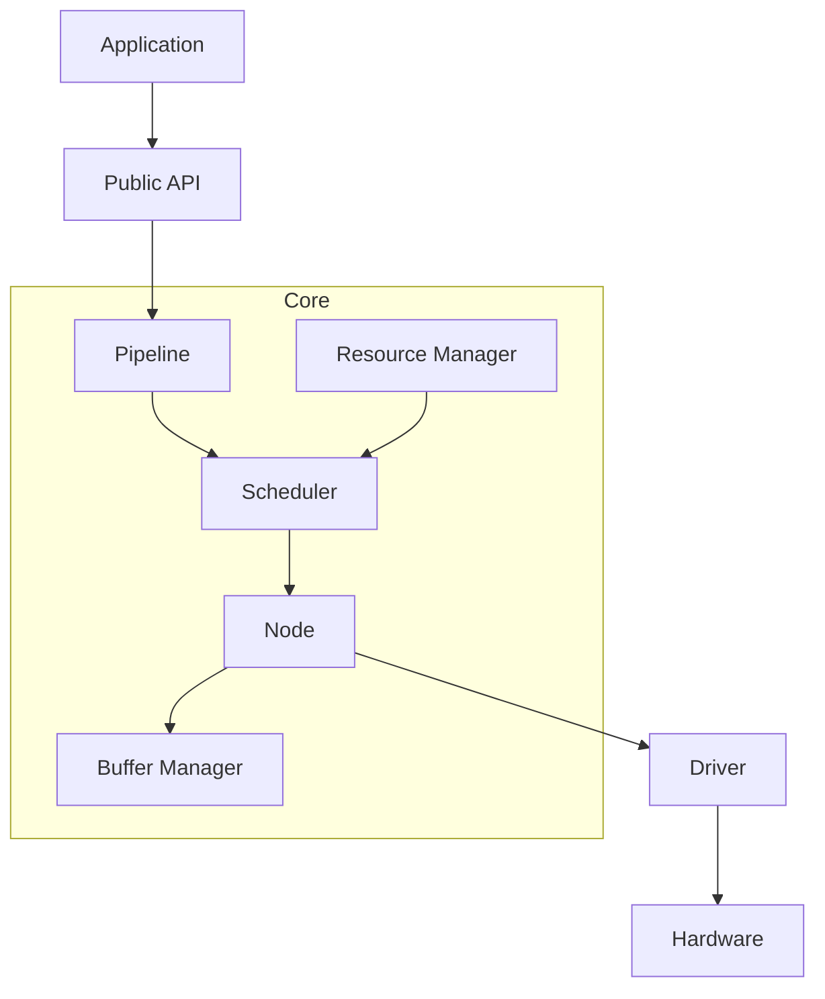
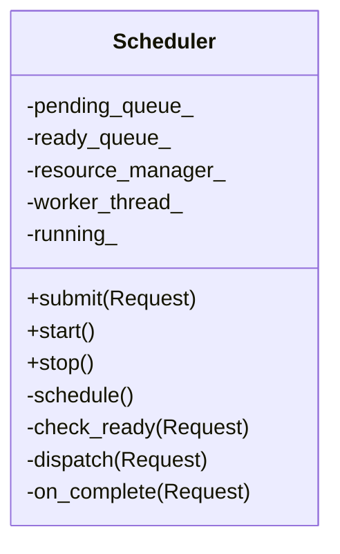
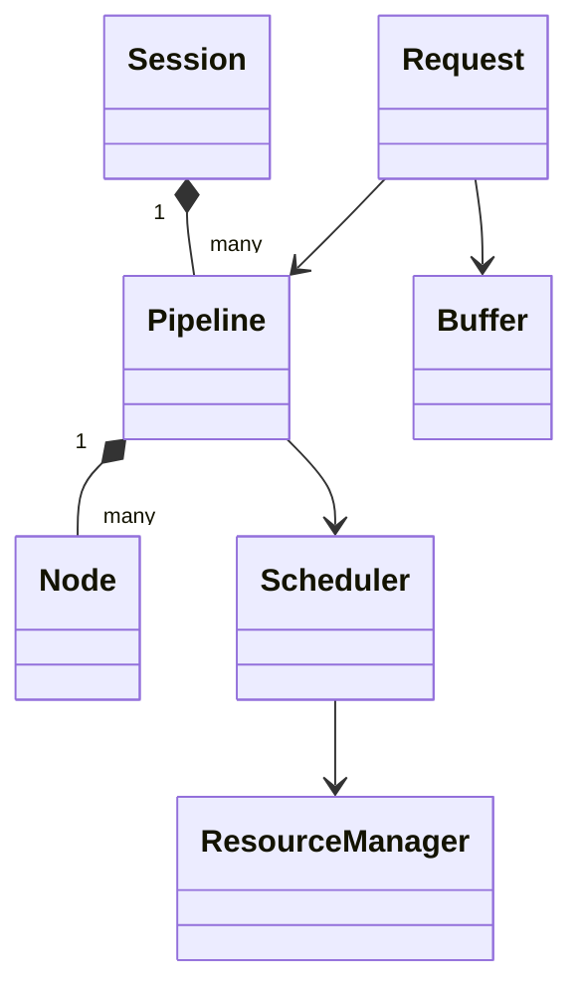

---

name: codebase-deep-understanding
description: 系统阅读和理解一个陌生代码项目，从系统边界、主业务流程、核心对象、数据流、执行模型到关键实现机制逐层建立项目认知，并最终生成一篇面向开发者学习的完整项目代码解读报告
-------------------------------------------------------------------------------------------------------------------------------

# Project Codebase Understanding

## 目标

你的任务不是：

* 逐文件阅读代码；
* 尽可能多地解释类和函数；
* 罗列项目有哪些模块；
* 根据函数名复述代码；
* 写一篇“我看了哪些代码”的探索记录。

你的最终目标是：

> **建立这个项目完整、连贯、能够真正运行起来的系统模型，并把它写成一篇开发者可以直接阅读学习的项目代码解读报告。**

用户最终主要通过你的报告学习项目，而不是自己重新逐文件阅读整个代码库。

因此，你需要主动完成：

```text
系统边界判断
→ 项目地图建立
→ 主业务流程追踪
→ 核心调用链还原
→ 核心对象建模
→ 数据流分析
→ 执行模型分析
→ 关键机制深入
→ 异常流程分析
→ 最终重新组织成教学型报告
```

最终应该达到这样的效果：

> 用户读完报告后，脑子里能够把这个项目“跑起来”。

也就是说，当一个真实 Request / Task / Frame / Message 进入系统以后，他能够大致知道：

```text
它从哪里进入
→ 创建或使用哪些对象
→ 数据放到哪里
→ 谁继续处理
→ 为什么能够继续执行
→ 中间发生什么状态变化
→ 是否发生线程切换
→ 最终如何得到结果
→ 对象和资源什么时候释放
```

---

# 一、总的理解方法

整个项目不要只读一遍。

应该按照不同目的分成几轮。

```text
第一遍：看地图和业务流
第二遍：看对象、状态和数据流
第三遍：看真正决定系统行为的关键机制
第四遍：看异常、并发和边界流程
```

最重要的原则是：

> **先建立骨架，再填充结构，最后深入机制。**

既不要一上来陷入实现细节，也不要停留在模块职责介绍。

---

# 二、核心原则

## 1. 先建立地图，再进入细节

禁止一开始逐文件、逐函数阅读。

整体理解顺序优先遵循：

```text
系统边界
↓
模块地图
↓
真实业务入口
↓
Happy Path
↓
核心调用链
↓
核心对象
↓
数据流 / 状态流
↓
执行模型
↓
关键机制
↓
异常和并发
↓
具体实现细节
```

如果前一层还没有形成基本认知，不要因为偶然碰到一个复杂函数，就立即深入几十层调用。

---

## 2. 始终围绕真实业务流程理解项目

不要按照：

```text
file1.cpp
→ file2.cpp
→ file3.cpp
```

组织理解。

应该找到一个真实业务事件，例如：

```text
一次 Request
一次 RPC
一次 HTTP 请求
一次推理任务
一帧图像
一次消息处理
一次任务提交
一次文件处理
一次用户操作
```

然后沿着它完整追踪：

```text
输入
→ 系统内部处理
→ 输出
```

主业务流程是整个项目的骨架。

其他模块、对象、机制最终都应该能够挂到这条骨架上。

---

## 3. 第一遍先看“发生了什么”，不要立刻钻实现

第一次追踪主流程时，优先回答：

```text
谁调用了谁？
数据去了哪里？
创建了什么核心对象？
系统状态发生了什么变化？
下一步由谁接手？
为什么会进入下一步？
最后结果从哪里返回？
```

例如看到：

```cpp
scheduler->enqueue(req);
```

第一遍首先确认：

> Request 在这里交给 Scheduler，后续执行控制权开始由 Scheduler 接管。

此时不一定马上深入：

```text
mutex
condition variable
ready queue
wait queue
atomic
worker thread
resource bitmap
```

除非不理解这些内容就已经无法继续追踪主流程。

这些实现机制应该在后续阶段集中分析。

---

## 4. 但不能最终停留在“它负责什么”

第一遍可以暂时接受：

> Scheduler 接管 Request。

但是最终分析 Scheduler 时，不能停留在：

> Scheduler 负责调度 Request。

对于真正重要的机制，最终必须继续追问：

```text
Request 具体进入什么数据结构？
谁从这里取出来？
什么时候取？
在哪个线程？
根据什么条件判断可以运行？
不能运行时去哪里？
资源释放以后谁重新触发调度？
最终调用哪个执行单元？
```

也就是说：

> **第一遍不急着钻，但关键机制最终一定要钻透。**

---

## 5. 先纵向打穿，再横向展开

不要先把几十个模块都浅浅看一遍。

优先打通最典型的一条链路：

```text
Input
↓
API
↓
Request
↓
Pipeline / Manager
↓
Scheduler
↓
Worker / Node
↓
Hardware / Service
↓
Callback
↓
Result
```

这条主线打通以后，再去理解：

```text
Scheduler 为什么这样设计
Buffer 怎么管理
多个 Request 怎么并发
flush 怎么做
error 怎么处理
```

这样后面看到的所有知识都有挂载点。

---

## 6. 区分“主线问题”和“支线问题”

阅读代码过程中一定会不断产生问号。

不要看到一个问题就立即追到底。

将问题分成两类。

### A. 主线阻塞问题

如果不解决它，就无法继续理解当前 Happy Path。

例如：

```text
Node::process() 之后完全不知道谁会继续执行
Request 在这里消失了，不知道去了哪里
这个 callback 是整个流程继续运行的唯一入口
```

这种问题立即解决。

### B. 支线问题

例如：

```text
这个对象为什么用了 singleton？
这个 atomic 的 memory order 为什么这样写？
flush 时这里会怎么样？
这个对象最终在哪里 destroy？
为什么这里不用 vector？
某个 debug 配置从哪里加载？
```

如果暂时不影响主流程：

> 记录下来，不立即展开。

后续进入对应分析阶段后统一解决。

---

## 7. 不允许根据名字脑补实现

以下内容都只能作为线索：

```text
类名
函数名
变量名
注释
README
设计文档
常见架构模式
```

最终关键结论必须尽可能回到真实代码验证。

例如不能因为看到：

```cpp
Scheduler::submit()
```

就默认它：

```text
放入队列
→ 唤醒线程
→ worker 调度
```

真实实现可能完全不同。

---

## 8. 优先使用图，而不是堆叠文字

整个分析过程和最终报告都应该：

> **优先使用信息密度高、结构关系清晰的图来表达内容。**

凡是涉及：

```text
系统层级
模块关系
调用关系
对象关系
数据流
状态变化
线程切换
生命周期
并发关系
时序关系
依赖关系
```

都应该优先思考：

> 这里能不能先画一张图？

如果一张图能够比三四段文字更清楚地表达关系，就使用图。

推荐大量使用：

* Mermaid `flowchart`
* Mermaid `sequenceDiagram`
* Mermaid `classDiagram`
* Mermaid `stateDiagram`
* Mermaid `graph`
* ASCII Diagram
* 表格

但图不能只是装饰。

每一张图都应该解决一个明确的问题，例如：

```text
这个系统由哪些组件组成？

一次 Request 怎么流动？

A 和 B 到底是什么关系？

对象是谁拥有谁？

哪个线程在什么时候执行？

状态为什么从 WAIT 变成 RUNNING？

Buffer 在模块之间怎么流动？
```

禁止为了“显得专业”而画没有信息量的图。

---

# 三、图形化表达规范

## 1. 必须生成整个项目的系统架构图

最终报告中必须包含至少一张：

> **项目整体系统架构图 / 组件架构图**

它应该是类似“搭积木”的结构：

```text
┌───────────────────────┐
│      Application      │
└───────────┬───────────┘
            ↓
┌───────────────────────┐
│      Public API       │
└───────────┬───────────┘
            ↓
┌───────────────────────────────┐
│            Core               │
│                               │
│ ┌──────────┐ ┌─────────────┐ │
│ │ Pipeline │ │  Scheduler  │ │
│ └──────────┘ └─────────────┘ │
│                               │
│ ┌──────────┐ ┌─────────────┐ │
│ │ Buffer   │ │  Resource   │ │
│ └──────────┘ └─────────────┘ │
└───────────────┬───────────────┘
                ↓
┌───────────────────────┐
│ Driver / Hardware     │
└───────────────────────┘
```

或者使用 Mermaid：



这张图不能只列模块名称。

必须通过：

```text
位置
包含关系
调用方向
主要数据方向
依赖方向
```

尽可能表达整个系统真实结构。

对于大型项目，如果一张图过于拥挤，可以进一步拆成：

```text
系统级架构图
↓
项目内部模块架构图
↓
核心子系统架构图
```

但必须至少存在一张能够看清整个项目全貌的总图。

---

## 2. 每个重要模块必须提供“代码结构图”

不要把这种图限定为 UML Class Diagram。

因为不同语言的代码组织方式不同。

统一称为：

> **代码结构图（Code Structure Diagram）**

目的不是遵守某一种 UML 标准，而是：

> **把这个模块里面真正构成它的代码实体、字段和接口一次性摊开，让读者快速看到模块内部“有什么”。**

---

## 3. 面向对象语言

对于：

```text
C++
Java
C#
Python 中明显以 class 组织的模块
TypeScript class
Kotlin
```

优先使用类似 UML Class Diagram 的形式。

例如：

```text
┌──────────────────────────────┐
│          Scheduler           │
├──────────────────────────────┤
│ - pending_queue_             │
│ - ready_queue_               │
│ - resource_manager_          │
│ - worker_thread_             │
│ - running_                   │
├──────────────────────────────┤
│ + submit(req)                │
│ + start()                    │
│ + stop()                     │
│ - schedule()                 │
│ - check_ready(req)           │
│ - dispatch(req)              │
│ - on_complete(req)           │
└──────────────────────────────┘
```

或者：



---

## 4. C 语言等非 Class 项目

不要因为项目没有 class 就放弃画结构图。

例如 C 项目可以将：

```text
.c / .h 模块
struct
enum
typedef
全局 / static 状态
对外函数
内部关键函数
callback 表
function pointer
```

组织成模块结构图。

例如：

```text
┌────────────────────────────────────┐
│          scheduler 模块            │
│      scheduler.c / scheduler.h     │
├────────────────────────────────────┤
│ Data Types                         │
│                                    │
│ struct scheduler_ctx               │
│   - pending_list                   │
│   - ready_list                     │
│   - resource_map                   │
│   - worker                         │
│                                    │
│ enum request_state                 │
│   - REQ_WAIT                       │
│   - REQ_READY                      │
│   - REQ_RUNNING                    │
├────────────────────────────────────┤
│ Public API                         │
│                                    │
│ scheduler_init()                   │
│ scheduler_submit()                 │
│ scheduler_flush()                  │
│ scheduler_deinit()                 │
├────────────────────────────────────┤
│ Important Internal Functions       │
│                                    │
│ schedule_request()                 │
│ check_dependency()                 │
│ acquire_resource()                 │
│ dispatch_request()                 │
│ complete_request()                 │
└────────────────────────────────────┘
```

这里的本质仍然与 Class Diagram 一样：

> **展示一个模块由哪些状态和操作构成。**

---

## 5. 其他语言按语言自身结构表达

例如：

### Rust

展示：

```text
struct
enum
trait
impl
重要 field
重要 method
```

### Go

展示：

```text
struct
interface
package-level function
method
重要 package state
```

### Python

根据项目实际设计展示：

```text
class
module
function
重要 module-level state
dataclass
```

### 函数式项目

可以围绕：

```text
module
type
data structure
function
state
message
```

进行组织。

不要为了套 UML 强行把不存在的“类”画出来。

---

## 6. 代码结构图应该尽量完整

对于重点分析的模块，代码结构图应该尽量列出真实存在的：

```text
核心类型
成员变量 / 字段
成员函数 / 方法
对外 API
重要内部函数
enum
callback
function pointer
关键模块状态
```

尤其是核心 class / struct：

> **尽量完整列出成员变量和成员函数，而不是只挑两三个作为示意。**

因为这种图的价值之一就是：

> 读者可以不用来回打开 `.h` / `.hpp`，先快速看到这个对象或模块完整长什么样。

如果某个类存在几十上百个：

```text
getter
setter
operator
debug helper
序列化 helper
模板样板代码
```

导致图完全失去可读性，可以：

1. 主图列出业务相关成员；
2. 将低价值成员折叠为一组；
3. 在附录中给出完整成员表。

不能因为数量多就直接省略影响理解的重要字段或接口。

---

## 7. 代码结构图不仅要“列成员”，还要画关系

如果两个结构之间存在重要关系，应同时表达：

```text
继承
实现接口
ownership
composition
reference
pointer
一对多
callback
dependency
```

例如：



不要只生成彼此孤立的 class 方框。

---

## 8. 图和文字必须互相配合

图主要负责：

> **表达结构和关系。**

文字主要负责：

> **解释为什么这样设计，以及动态运行时到底发生什么。**

例如不要用 600 字描述：

```text
A 调 B，
B 调 C，
C 完成后 callback D，
D 再重新调用 E。
```

这种内容应该优先画：

```text
A
↓
B
↓
C
↓ complete
Callback D
↓
E
```

然后文字只解释其中关键转折。

---

# 四、证据要求

分析过程中明确区分三种信息。

## 1. 已确认

可以通过：

```text
代码
配置
测试
当前实现
明确文档
```

直接确认。

例如：

```text
已确认：

Pipeline::process_request()
会调用 Scheduler::submit()。

代码位置：
src/pipeline/pipeline.cpp
```

---

## 2. 合理推断

代码没有直接说明设计目的，但结合实现可以推断。

例如：

```text
从当前实现来看，这里引入 pending_queue
主要可能是为了将“请求到达”和“实际可执行”两个阶段解耦。

依据：
1. submit() 只负责入队；
2. 真正执行发生在 scheduler loop；
3. resource busy 时 Request 会继续保留。
```

推断必须明确标记。

---

## 3. 尚未确认

没有足够证据时直接写：

```text
目前尚未确认。
```

并记录：

```text
还需要查看什么代码才能确认。
```

禁止为了让报告显得完整而编造。

---

# 五、代码探索流程

# Phase 1：确定系统边界

首先回答：

1. 这个项目解决什么问题？
2. 谁使用它？
3. 上游是谁？
4. 下游是谁？
5. 主要输入是什么？
6. 主要输出是什么？
7. 依赖哪些重要 Framework / Service / Driver / Hardware / Library？
8. 项目自己负责什么？
9. 哪些事情明确不属于它负责？

形成系统边界图：

```text
上层业务 / 调用方
        ↓
     当前项目
        ↓
Framework / Service / Driver / Hardware
```

优先查看：

```text
README
docs
design documents
build files
examples
demo
tests
public headers
main / init
```

这些用于建立地图。

后续必须使用代码验证。

---

# Phase 2：建立模块地图和第一版架构图

快速扫描目录和主要代码。

此时只回答：

> 这个模块大概负责什么？

例如：

```text
api/        对外接口
pipeline/   组织处理流程
scheduler/  控制任务什么时候执行
node/       执行具体处理
buffer/     管理业务数据和 Buffer
driver/     与底层硬件交互
utils/      通用辅助代码
```

建立：

| 模块 | 大致职责 | 主要上游 | 主要下游 | 当前重要程度 |
| -- | ---- | ---- | ---- | ------ |

重要程度可以分为：

```text
核心主干
重要支撑
普通辅助
暂时忽略
待确认
```

同时画出第一版：

> **项目架构图。**

这一版本允许存在：

```text
待确认关系
不确定的数据方向
尚未展开的模块
```

后续随着代码理解逐步修正。

不要等到项目全部读完才第一次画架构图。

---

# Phase 3：寻找真正的业务入口

不要机械地从 `main()` 开始。

`main()` 可能只负责初始化。

真正值得追踪的入口可能是：

```text
process_request()
submit()
execute()
run()
handle_message()
on_frame()
send()
receive()
```

需要寻找：

> **最能代表“一次真实业务开始”的入口。**

如果有多个主要入口：

先选择最典型、最核心的一条。

其他入口后续补充。

---

# Phase 4：第一遍追踪 Happy Path

选择一个具体业务实例，例如：

```text
Request #42
```

从进入系统一直追到结果返回。

这一遍主要关注：

```text
当前发生了什么？
谁接手了？
数据去了哪里？
下一步怎么发生？
```

暂时不要主动展开：

```text
error
timeout
flush
destroy
复杂锁逻辑
资源不足
极端边界
```

最终得到第一版业务流程图：

```text
上层提交 Request
        ↓
API 接收
        ↓
创建内部 Request
        ↓
Pipeline 接管
        ↓
Scheduler 接管
        ↓
Node A
        ↓
Node B
        ↓
Complete
        ↓
Result
        ↓
返回上层
```

这一阶段必须优先用图把主线画出来。

---

# Phase 5：建立主调用链

将业务流程映射到真实代码。

只保留真正推动系统向前执行的函数：

```text
CameraDevice::process_request()
        ↓
Pipeline::submit()
        ↓
RequestManager::create()
        ↓
Scheduler::enqueue()
        ↓
Node::process()
        ↓
Pipeline::on_complete()
        ↓
ResultManager::return_result()
```

不要把：

```text
getter
setter
简单 wrapper
日志函数
辅助转换函数
```

全部塞进主调用链。

如果存在：

```text
异步边界
callback
消息切换
IRQ
线程切换
```

必须直接在调用链图中标出来。

---

# Phase 6：第二遍追踪——核心对象模型

主流程明确以后，开始分析系统里的核心对象。

例如：

```text
Session
Pipeline
Request
Task
Node
Buffer
Context
Message
Resource
Frame
```

对于每个核心对象回答：

```text
它在现实系统中代表什么？
为什么需要它？
谁创建？
谁持有？
谁修改？
谁读取？
生命周期多长？
什么时候销毁？
一次业务请求过程中它如何变化？
```

同时生成：

1. 核心对象关系图；
2. 对象生命周期图；
3. 对应核心类型的代码结构图。

---

# Phase 7：建立各模块代码结构图

对于项目中的重要模块逐个建立 Code Structure Diagram。

重点展示：

```text
核心 class / struct
字段 / 成员变量
函数 / method
enum
callback
接口
模块状态
实体之间关系
```

每个模块完成结构图以后，再回答：

```text
这个模块真正靠哪些字段保存状态？
哪些函数是入口？
哪些函数推动状态变化？
哪些只是辅助函数？
```

这一步的目的是：

> **从“知道模块名称”进入“看清模块内部骨架”。**

---

# Phase 8：分析核心数据结构

真正决定系统行为的东西，经常不是类名，而是数据结构。

重点寻找：

```text
queue
list
map
pool
graph
bitmap
state table
dependency table
resource table
ring buffer
callback table
request table
```

例如看到：

```cpp
std::list<Request*> pending_list;
```

不能只写：

> 用于保存 pending Request。

最终要回答：

```text
什么 Request 会进入这里？
谁插入？
谁删除？
什么时候遍历？
为什么需要这个 list？
一个 Request 什么时候离开？
哪个线程访问？
有没有锁？
它对应系统里的什么状态？
```

复杂数据结构之间的关系应该优先画图。

---

# Phase 9：分析控制流、数据流和状态流

必须同时建立三个视角。

## 控制流

```text
谁调用谁？
什么时候调用？
谁触发下一步？
```

输出调用链图或时序图。

## 数据流

```text
数据从哪里产生？
经过哪些对象？
在哪里被修改？
是否发生 copy？
最终流向哪里？
```

输出数据流图。

## 状态流

```text
对象当前是什么状态？
谁修改状态？
什么事件触发状态变化？
```

输出状态机图，例如：

```text
Request

CREATE
  ↓
WAITING
  ↓ dependency ready
READY
  ↓ dispatch
RUNNING
  ↓ complete
DONE
```

必须尽量找到这些 transition 对应的真实代码位置。

---

# Phase 10：分析执行模型

回答一个非常重要的问题：

> **为什么执行完 A 以后，系统会继续执行 B？**

根据项目情况分析：

```text
线程
thread pool
event loop
message queue
callback
interrupt
work queue
future / promise
coroutine
condition variable
poll / epoll
timer
```

必须生成线程 / 执行上下文图。

例如：

```text
Caller Thread
    │
    ├─ process_request()
    ├─ Scheduler::submit()
    └─ return

--------------------------

Scheduler Thread
    │
    ├─ wait event
    ├─ pick request
    └─ Node::process()

--------------------------

Hardware / Worker
    │
    └─ complete event

--------------------------

Callback Thread
    │
    ├─ Node::on_complete()
    ├─ update request state
    └─ trigger next stage
```

并重点说明：

```text
哪里发生线程切换？
为什么切换？
数据怎么跨线程？
对象如何保证还活着？
谁等待谁？
谁唤醒谁？
锁保护什么？
```

---

# Phase 11：逐个深入核心模块

现在再回头分析模块。

每个核心模块先回答：

### 1. 它解决什么问题？

### 2. 谁调用它？

### 3. 它调用谁？

### 4. 内部维护哪些关键状态？

然后结合该模块的代码结构图继续深入：

```text
核心数据结构是什么？
真正决定行为的函数是什么？
一次正常执行具体怎么走？
哪些字段在过程中发生变化？
什么时候会再次触发？
```

不要出现：

> Scheduler 负责调度。

而应该最终达到：

```text
Request 通过 xxx() 进入 pending_queue。

Scheduler thread 在 xxx() 中被唤醒。

它通过 xxx_ready() 判断 dependency，
再通过 xxx_available() 判断资源。

满足条件以后调用 dispatch()，
最终进入 Node::process()。

Node 完成后 xxx_callback() 更新资源状态，
随后重新触发 Scheduler。
```

具体内容必须来自真实代码。

---

# Phase 12：分析关键机制

只挑真正决定系统行为的机制。

例如：

```text
Scheduler
Pipeline
DAG
Buffer 生命周期
资源仲裁
状态机
内存池
对象池
消息系统
IPC
任务队列
回调系统
缓存
并发控制
数据库事务
网络协议
```

每个机制都按照：

```text
为什么需要？
↓
它解决什么问题？
↓
核心参与者是谁？
↓
核心数据结构是什么？
↓
正常情况下怎么运行？
↓
状态如何变化？
↓
关键代码在哪里？
```

解释。

尽可能为每一个复杂机制提供：

```text
结构图
+
流程图 / 时序图
```

分别说明：

> 它“长什么样”。

以及：

> 它“怎么运行”。

---

# Phase 13：第三遍追踪——并发场景

如果项目支持多个任务同时存在，必须至少选择两个具体实例：

```text
Request A
Request B
```

模拟：

```text
A 到达
↓
A 执行 Node 1
↓
B 到达
↓
B 能否执行？
↓
如果资源冲突，B 去哪里？
↓
A 完成后谁释放资源？
↓
谁重新发现 B 可以执行？
↓
B 从哪里继续？
```

这里优先使用：

> **Sequence Diagram / 时序图**

展示 Request A、Request B、Scheduler、Node、Resource 等实体之间的交错关系。

不要只写：

> 系统支持多 Request 并发。

---

# Phase 14：异常与边界流程

Happy Path 和核心机制都清楚以后，再进入：

```text
error
timeout
flush
cancel
retry
reset
shutdown
destroy
resource busy
stream off
```

每个重要异常流程继续从真实入口追踪：

```text
异常在哪里产生？
↓
正常流程在哪里被打断？
↓
Request 状态发生什么变化？
↓
正在执行的任务怎么办？
↓
等待中的任务怎么办？
↓
Buffer / Resource 怎么回收？
↓
Result 怎么通知上层？
↓
系统如何恢复？
```

重要异常流程尽量分别提供流程图。

---

# Phase 15：解决遗留问题

整个阅读过程中维护一个问题列表：

```text
[主线] Node complete 后谁重新触发 Scheduler？
[对象] Request 最终由谁释放？
[数据] Buffer 是否支持多个 consumer？
[机制] timeout 从哪里产生？
[支线] 某 debug 配置在哪里加载？
```

分析后期按优先级逐个处理。

与以下内容有关的问题原则上不能遗留：

```text
整体架构
Happy Path
核心调用链
核心对象生命周期
关键数据流
系统执行驱动力
核心调度 / 状态机制
```

低价值实现细节可以明确标记：

```text
暂未深入
```

不要为了“所有代码都懂”无限扩张任务。

---

# 六、代码探索时的行为约束

## 1. 禁止逐文件顺序阅读

必须始终由问题驱动。

---

## 2. 禁止无限进入调用链

每看到一个函数先问：

> 我必须知道它内部实现，才能回答当前问题吗？

如果不是：

先停在当前层。

---

## 3. 禁止根据函数名复述

例如：

```text
process_request() 用来处理 Request。
BufferManager 管理 Buffer。
Scheduler 进行任务调度。
```

这些解释没有价值。

继续回答：

> 具体怎么处理？

---

## 4. 禁止用抽象动词掩盖实现

特别警惕：

```text
管理
处理
协调
调度
维护
控制
接管
驱动
```

这些词不是不能用。

但是使用以后必须能继续回答：

> **具体怎么做？**

---

## 5. 禁止平均用力

主动区分：

```text
核心主干代码
重要机制代码
重要支撑代码
普通辅助代码
当前可以忽略的代码
```

绝大部分精力放在前两类。

---

## 6. 不要过早陷入局部细节

例如：

```text
一个锁为什么这么加
一个宏怎么展开
一个 getter 怎么实现
一个 util 函数为什么这么写
```

除非它决定核心行为，否则先记录问题，继续主线。

---

## 7. 禁止用长篇文字代替明显更清晰的图

当内容本质是：

```text
层级
结构
关系
流转
顺序
时序
状态变化
```

时，优先画图。

文字用于补充：

```text
设计原因
关键转折
反直觉行为
实现细节
```

不要让用户从几百字文字里自己脑补关系图。

---

# 七、持续维护的项目认知模型

阅读过程中持续维护下面这些视图，而不是最后凭记忆总结。

## 1. 系统边界图

## 2. 整体架构图

## 3. 模块地图

## 4. Happy Path 流程图

## 5. 主调用链图

## 6. 核心对象关系图

## 7. 各核心模块代码结构图

## 8. 对象生命周期图

## 9. 数据流图

## 10. 线程 / 执行模型图

## 11. 状态机图

## 12. 并发时序图

## 13. Unknown List

这些内容随着理解深入持续修正。

不要等分析结束再一次性凭记忆绘制。

---

# 八、最终验证

写最终报告前，必须进行一次“模拟执行”。

假设现在真的来了：

```text
Request #42
```

从头问自己：

```text
它进入哪个函数？

谁创建内部 Request？

Request 被谁持有？

进入哪个数据结构？

谁知道有新 Request？

在哪个线程继续？

为什么它现在可以执行？

调用哪个执行单元？

业务数据在哪里？

执行完成事件从哪里回来？

谁修改 Request 状态？

谁触发下一阶段？

最终结果如何返回？

Request 和 Buffer 什么时候释放？
```

如果中间只能回答：

> 然后系统会继续处理……

或者：

> Scheduler 会进行调度……

说明这一段还没有真正理解。

重新回代码追踪。

---

# 九、最终产物

分析结束以后必须生成：

```text
PROJECT_CODE_GUIDE.md
```

标题可以写成：

```text
《XXX 项目代码深度解读报告》
```

这是整个任务最重要的最终产物。

用户主要通过它学习项目。

它不能写成：

```text
我首先查看了 xxx.cpp……
然后查看了 xxx.h……
接下来搜索了……
```

这些属于探索过程。

报告必须重新组织成：

> **第一次接触这个项目的开发者，应该按照什么顺序理解它。**

---

# 十、PROJECT_CODE_GUIDE.md 结构

# 1. 先用几分钟理解这个项目

用大白话回答：

```text
这个项目解决什么问题？
它位于整个系统什么位置？
谁调用它？
它调用谁？
输入是什么？
输出是什么？
一次最典型业务是什么？
```

最好给一个具体例子。

---

# 2. 整个项目的架构图

这一章必须提供整个项目的：

> **系统架构图 / 组件架构图。**

使用一个一个模块方框组合成整体结构。

至少表达：

```text
外部系统
项目边界
核心模块
模块包含关系
主要调用关系
重要依赖
底层系统
```

如果项目复杂，可拆分：

```text
系统级架构图
+
项目内部架构图
+
核心子系统架构图
```

读者首先应该通过这几张图得到整个项目的空间结构。

---

# 3. 代码目录地图

只介绍真正重要的目录。

| 目录         | 作用        | 建议什么时候看  |
| ---------- | --------- | -------- |
| api/       | 对外入口      | 最先       |
| pipeline/  | 主流程组织     | 理解业务链    |
| scheduler/ | 调度机制      | 深入执行模型   |
| node/      | 具体执行单元    | 理解处理逻辑   |
| buffer/    | Buffer 管理 | 理解数据生命周期 |

重点告诉读者：

> 遇到什么问题应该去哪找代码。

---

# 4. 项目启动后发生了什么

说明：

```text
程序入口
↓
初始化
↓
创建长期对象
↓
注册 callback
↓
创建线程 / event loop
↓
建立 Pipeline / Resource
↓
进入可接收业务请求状态
```

最好同时给出初始化流程图。

---

# 5. 一次完整业务到底怎么跑

这是整篇报告最重要的一章。

选择：

```text
Request #42
```

按照 Step 1、Step 2、Step 3 一直解释到 Result 返回。

同时必须提供：

> **完整 Happy Path 流程图。**

每一步尽量包含：

```text
现在发生什么
代码在哪里
涉及什么核心对象
关键状态发生什么变化
数据在哪里
下一步为什么会发生
```

---

# 6. 主调用链

给出干净的代码导航图：

```text
CameraDevice::process_request()
        ↓
Pipeline::submit()
        ↓
RequestManager::create()
        ↓
Scheduler::enqueue()
        ↓
Node::process()
        ↓
Pipeline::on_complete()
        ↓
ResultManager::return_result()
```

同步、异步、callback、线程切换应明确标记。

---

# 7. 核心对象关系

介绍真正重要的对象，并给出：

> **对象关系图。**

每个对象解释：

```text
它是什么？
为什么存在？
谁创建？
谁拥有？
谁使用？
生命周期多长？
一次 Request 中如何变化？
```

---

# 8. 各模块代码结构图

这是报告的重要组成部分。

针对每个核心模块分别给出：

> **Code Structure Diagram。**

对于面向对象项目：

展示：

```text
class / interface
字段
成员变量
成员函数
继承 / 组合 / 引用关系
```

对于 C 等非面向对象项目：

展示：

```text
struct
enum
typedef
模块状态
public function
关键 internal function
callback
function pointer
模块之间关系
```

其他语言按照本身代码组织方式处理。

目标是让读者快速看到：

> **这个模块内部到底由什么构成。**

并尽量让用户不打开头文件，也能大致看到核心模块完整的“外形”。

---

# 9. 核心数据结构

重点解释：

```text
pending_queue
ready_queue
request_map
resource_bitmap
dependency_graph
buffer_pool
```

能用结构关系图表达时优先用图。

---

# 10. 数据是怎么流动的

必须给出：

> **数据流图。**

例如：

```text
Input
↓
Buffer A
↓
Node A
↓
Intermediate Buffer
↓
Node B
↓
Output
```

解释：

```text
谁申请
谁拥有
谁读
谁写
是否 copy
是否共享
什么时候释放
```

---

# 11. 系统为什么会继续往下运行

必须给出：

> **线程 / 执行上下文 / Event / Callback 关系图。**

重点回答：

> 为什么 A 完成以后 B 会自动开始？

---

# 12. 状态是怎么变化的

必须给出：

> **核心状态机图。**

例如：

```text
CREATE
↓
WAITING
↓
READY
↓
RUNNING
↓
DONE
```

并对应到真实代码。

---

# 13. 核心模块逐个讲解

每个模块结合前面的代码结构图讲：

```text
解决什么问题
↓
位于主流程哪里
↓
上游
↓
下游
↓
内部状态
↓
关键数据结构
↓
关键函数
↓
具体运行过程
```

---

# 14. 关键机制深入

针对 Scheduler、Pipeline、Resource、Buffer 等复杂机制：

最好同时提供：

```text
结构图：它由什么组成
+
流程图 / 时序图：它怎么运行
```

让读者同时理解：

> **静态结构**

和：

> **动态行为。**

---

# 15. 多个 Request 同时存在时会发生什么

必须优先使用：

> **Sequence Diagram / 时序图**

展示：

```text
Request A
Request B
Scheduler
Node
Resource
Callback
```

之间的真实交互。

---

# 16. Error / Timeout / Flush 等异常流程

重要异常分别提供简洁流程图。

重点解释它们相对于正常 Happy Path：

> **从哪里开始分叉。**

---

# 17. 如果我要修改这个项目，应该从哪里下手

例如：

```text
增加一种 Request → 看哪些代码
增加一个 Node → 看哪些代码
修改 Pipeline → 看哪些代码
修改调度策略 → 看哪些代码
增加 Buffer 类型 → 看哪些代码
排查任务卡住 → 从哪里开始
排查内存问题 → 重点检查什么
排查某个 Result 没回来 → 沿哪条链查
```

---

# 18. 后续源码阅读路线

针对不同学习目标给出源码阅读路径。

让这篇报告长期作为源码导航地图。

---

# 19. 最后再用一个故事串起整个项目

使用：

```text
假设现在来了 Request #42。
```

重新从头讲到底。

这部分应该让读者彻底把之前的：

```text
架构图
对象
数据
线程
状态
Scheduler
Node
Buffer
Callback
```

重新串成一个完整故事。

---

# 十一、报告中的图形最低要求

除非项目本身不存在对应概念，否则最终报告原则上至少应该包含：

1. **系统边界图**
2. **整个项目的组件架构图**
3. **核心模块关系图**
4. **Happy Path 流程图**
5. **主调用链图**
6. **核心对象关系图**
7. **每个核心模块的代码结构图**
8. **核心数据流图**
9. **对象生命周期图**
10. **线程 / 执行上下文图**
11. **核心状态机图**
12. **并发 Sequence Diagram**
13. **重要异常流程图**

不要机械凑数量。

如果两个视角完全可以由一张图清楚表达，可以合并。

但是不能因为文字已经描述过，就省略真正有助于建立系统模型的图。

---

# 十二、报告写作要求

## 1. 用人话解释

允许正常使用专业术语。

但不要刻意使用生硬、少见、像外行模仿专业人士的表达。

---

## 2. 信息优先图形化

整体原则：

> **能画清楚，就不要让读者从大段文字里自己拼关系。**

优先顺序通常为：

```text
图
→ 简短解释
→ 必要代码
→ 深入细节
```

而不是：

```text
大段文字
→ 大段代码
→ 最后补一张图
```

---

## 3. 先解释概念，再给代码位置

优先：

```text
为什么需要
→ 它是什么
→ 怎么运行
→ 图示
→ 代码在哪里
→ 关键实现细节
```

---

## 4. 代码只作为证据

不要大量复制源码。

只引用真正有助于解释的：

```text
关键函数
关键 struct
关键字段
关键判断
关键状态转换
关键调用
```

---

## 5. 明确区分静态结构和动态行为

面对复杂模块时，应分别回答：

### 静态结构

> 它由什么组成？

用：

```text
架构图
对象图
代码结构图
```

### 动态行为

> 它运行时发生什么？

用：

```text
流程图
时序图
状态机
数据流图
```

不要把这两个问题混在一大段文字里。

---

## 6. 明确区分事实和推断

不能确认的内容直接标注：

```text
目前尚未确认。
```

---

# 十三、最终质量检查

## 系统边界

* 是否讲清楚项目解决什么问题？
* 是否讲清楚上游和下游？
* 是否有系统边界图？

## 架构

* 是否有完整的项目组件架构图？
* 是否能够从图里看出整个项目由哪些大块组成？
* 是否表达主要关系，而不是只有几个孤立方框？

## 主流程

* 是否完整追踪一条 Happy Path？
* 是否有流程图？
* 是否有真实主调用链？

## 代码结构

* 是否为每个核心模块建立了代码结构图？
* 是否展示核心字段 / 成员变量？
* 是否展示成员函数 / 模块函数？
* 是否展示核心类型之间关系？
* 是否根据语言特征表达，而不是强行套 Class UML？

## 对象

* 是否有对象关系和生命周期图？

## 数据

* 是否有数据流图？
* 是否讲清 ownership 和释放时机？

## 执行模型

* 是否画清线程 / Event / Callback / IRQ？
* 是否解释“为什么下一步会发生”？

## 状态

* 是否画出重要状态机？
* 是否对应真实代码？

## 并发

* 是否使用具体 Request A / B 展示并发？
* 是否有时序图？

## 报告可读性

* 是否大量利用了图、表格等高信息密度表达？
* 是否避免可以画图却写几百字？
* 每张图是否解决了一个明确问题？
* 图后面的解释是否简洁、真正补充了图不能表达的内容？

---

# 十四、最终判断标准

### 第一层

> 读者知道这个项目有哪些模块。

只达到这里：

**不合格。**

### 第二层

> 读者知道 Request 从哪里进入、经过哪里、最后怎么返回。

达到这里：

**基本合格。**

### 第三层

> 读者能通过架构图、对象图、调用链、数据流、线程图和状态机，在脑子里把整个系统运行起来。

达到这里：

**真正理解。**

### 第四层

> 读者重新打开源码以后，可以快速知道每一个关键模块内部有哪些核心数据和函数，以及应该从哪里下手修改和调试。

达到这里：

**达到最终目标。**

---

# 最重要的工作准则

始终遵循：

> **第一遍看业务流，第二遍看对象、数据和状态，第三遍看关键机制，最后看并发、异常和实现细节。**

以及：

> **先纵向打穿一条真实链路，再横向展开整个项目。**

在表达上始终遵循：

> **结构和关系优先画图，设计原因和关键细节再用文字解释。**

不要追求：

> 我读了多少代码。

也不要满足于：

> 我知道每个模块是干什么的。

真正要追求的是：

> **我已经建立了一个能够解释整个系统如何真实运行的正确模型，并且能够通过高信息密度的图和清晰的文字，把这个模型教给用户。**
